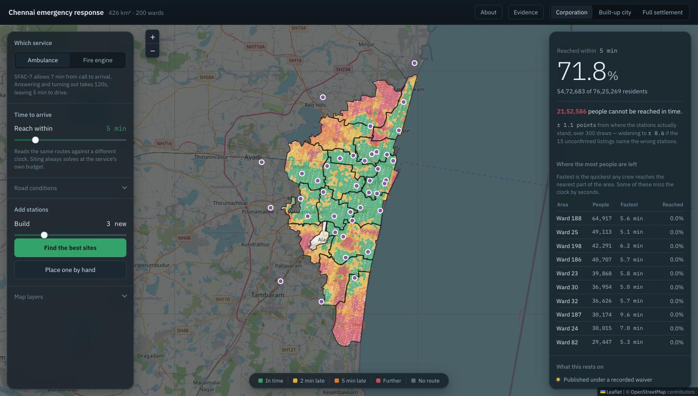
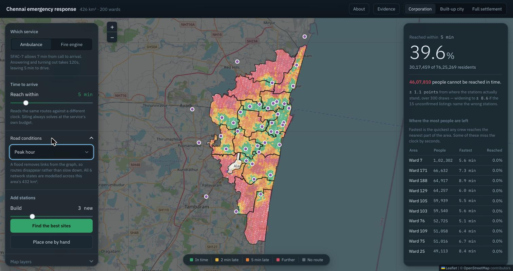
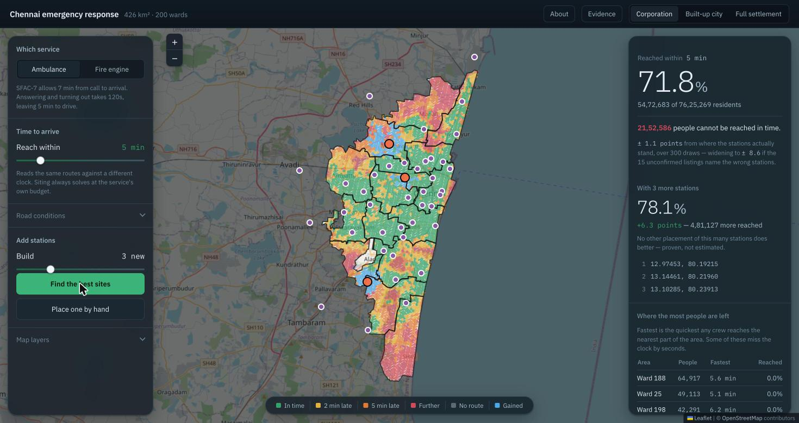
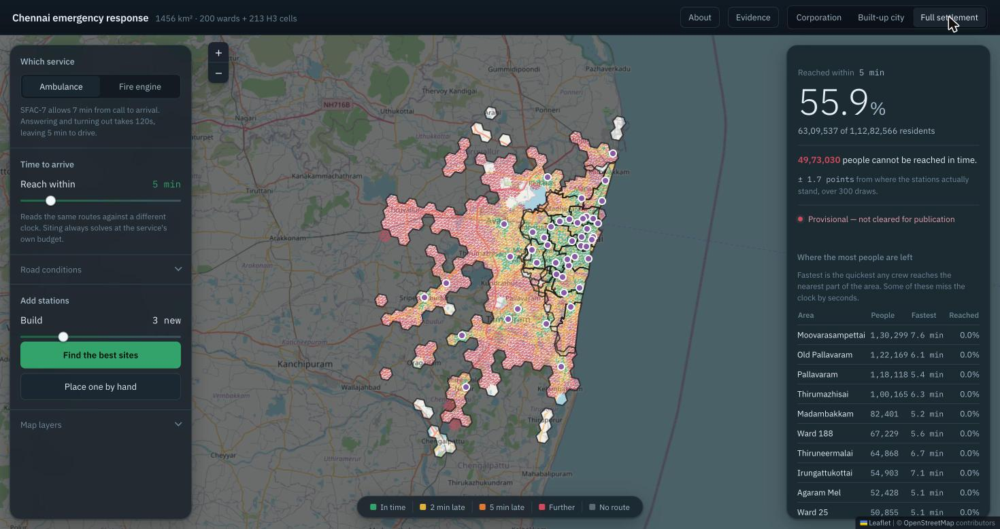
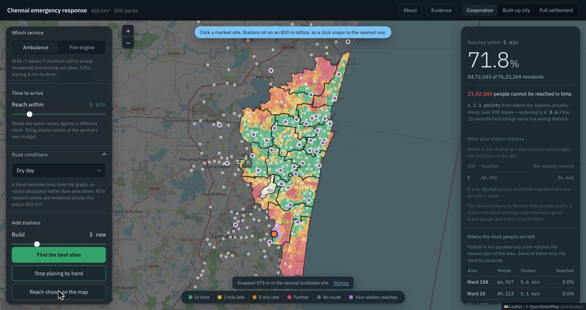
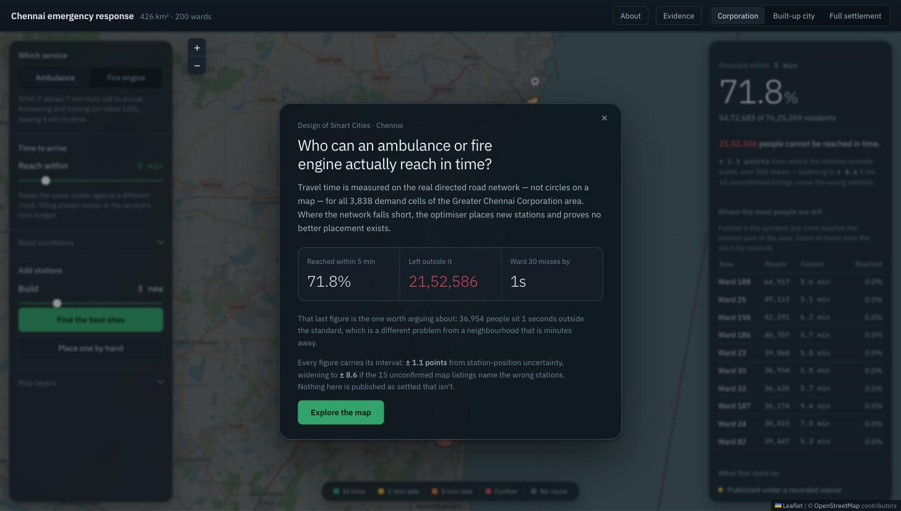

# Chennai Emergency Response — coverage and station siting

**Which parts of Chennai cannot be reached by a fire engine or an ambulance
within the mandated response time, and where would the next stations go?**

Chennai's fire service runs 39 stations over a corporation of 432 km² and
7.6 million people. Whether a crew arrives in time is a question about roads and
clocks, not about distance: a station 2 km away across the Cooum at peak hour is
further than one 5 km away on a trunk road. So this project measures travel time
on the **real directed road network** — one-ways, turn penalties, class speeds
calibrated against an independent routing oracle — and asks who is inside the
standard and who is not.

Where the network falls short, a **maximal covering location problem** (MCLP) is
solved to place new stations, with an exact mixed-integer program giving a
*proven* optimality gap rather than a plausible-looking guess. The same network
is then re-run under peak-hour congestion and four flood states, because a plan
that only works on a dry Tuesday is not a plan.



*Greater Chennai at the ambulance's 5-minute driving budget. Green is inside the
standard; red is more than 5 minutes late; grey has no route at all — a
distinction the map keeps because "not covered" and "unreachable" are different
problems. White rings are the 39 stations. The panel on the right lists the wards
holding the most people nobody reaches in time, with the fastest arrival any crew
can manage.*

> **Results are published under a recorded waiver, not on surveyed positions.**
> 34 of the 39 station positions are third-party map listings. Any coverage
> figure taken from this project must be quoted with its interval: **±1.10 points
> if the 15 unconfirmed listings name the right stations, ±8.55 if they do not.**
> The terms are in [`config/publish_waiver.yml`](config/publish_waiver.yml);
> setting `active: false` reverts every output to PROVISIONAL. See
> [What you can and cannot claim](#what-you-can-and-cannot-claim).

---

## What it found

Greater Chennai Corporation, 39 stations, 3,838 demand cells, 7,625,269 residents.

| | ambulance (SFAC-7) | fire engine |
|---|---|---|
| standard | 7 min call-to-arrival | 7 min call-to-arrival |
| answering + turnout | 120 s | 140 s |
| **leaving to drive** | **5 min** | **4 min 40 s** |
| **reached in time, dry day** | **71.77%** | **54.43%** |
| people outside it | **2,152,586** | 45.6% of risk-weighted demand |
| unreachable at any budget | 0 cells | 0 cells |

**Peak hour is worse than a 100-year flood.** Congestion takes ambulance coverage
to **39.57%**; the 100-year flood takes it to 52.42%. Every robust-siting strategy
agrees: the binding design-basis scenario is `peak`, not inundation.

| scenario | ambulance | fire |
|---|---|---|
| dry | 71.77% | 54.43% |
| 5-year flood | 66.47% | 49.45% |
| 25-year flood | 58.74% | 43.71% |
| 2015 flood (observed) | 63.22% | 47.83% |
| 100-year flood | 52.42% | 36.91% |
| **peak hour** | **39.57%** | **26.46%** |



*The same stations, the same standard, at peak hour. Coverage falls from 71.8% to
39.6% and 4.6 million people move outside the standard — a worse result than any
flood this project models. The ward table reorders completely: at peak the
biggest gaps are inner-city wards whose roads are full, not outlying ones.*

**Three well-placed stations buy more than six points.** Solved exactly on the
land-feasible candidate set, every run proven optimal:

| new stations | ambulance coverage |
|---|---|
| 0 (today) | 71.77% |
| 3 | 78.08% |
| 5 | 80.98% |
| 10 | 85.73% |



*Three new stations, solved exactly. Blue is ground the proposal brings inside
the standard — 4,81,127 more people, +6.3 points. The console states whether the
result was proven or merely the best found before a time limit; here it reports
"no other placement of this many stations does better — proven, not estimated",
and prints the coordinates.*

**Equity costs something, and the amount is measurable.** No siting of fewer than
**7** stations can give every ward non-zero coverage — that is a proven
structural bound, not an estimate. At k=10, maximising the worst ward instead of
the city total costs **6.29 points** of overall coverage.

**The site list is not identified, and that is the honest headline.** Under the
pessimistic position-error model, 85 distinct sites competed for 10 slots and
none was chosen in 95% of draws. The project therefore publishes a decision frame
— what each objective would buy, and what it would cost — rather than a ranked
list of addresses it cannot support.

## How it works

Six steps, each a script, each producing a hashed artefact.

**1. Who is where.** Population comes from **GHS-POP R2023A**, a 100 m global
raster, aggregated into **H3 resolution-9 hexagons** (~0.1 km²). Raster cells
carry a *count*, not a density, so each populated pixel is assigned whole to one
hexagon — mass-conserving by construction. Ward totals are then reconciled to
**Census 2011**, dasymetrically re-cut from the 155 wards the census was counted
on to the 200 wards that exist today, weighted by modelled population within each
intersection ([ADR-007](docs/adr/007-census-ward-reconciliation.md)).

**2. What the roads do.** The OSM drive network becomes a directed graph with a
speed per highway class, a junction-delay term, and a flat per-trip overhead.
Those parameters are **fitted**, not assumed: a grid search against an OSRM
oracle on real origin–destination pairs, scored on the median travel-time ratio
per distance band. The shipped configuration lands at **6.92% median absolute
percentage error**, worst distance band within **3.07%**.

**3. Who can be reached.** A Dijkstra sweep from every station gives each cell its
fastest arrival time. A cell is covered when that time fits inside the service's
*driving* budget — the standard minus call-answering and turnout, which is why
the ambulance gets 5 minutes out of 7.

**4. Where a station could go.** Candidate sites are generated on the road network
with an 800 m minimum separation, then flagged for land feasibility against OSM
parcels. A station can only be proposed where one could actually be built.

**5. Where they should go.** The MCLP is solved twice — a greedy pass carrying the
classical 1−1/e guarantee, and an exact MIP via HiGHS. Every published siting
states whether it was **proven optimal** or merely the best found before a time
limit. Three objectives are reported: maximise city coverage, maximise the worst
ward (maximin), and lexicographic (best coverage *subject to* the achievable ward
floor).

**6. What breaks it.** Peak hour rescales class speeds. Floods remove links
outright rather than slowing them, because the planner's question is not "is this
street wet" but "is this neighbourhood now cut off". Flood state comes from
Chennai Flows return-period layers and the observed 2015 inundation points.

Everything above is then **swept**: ±20% class speeds, the junction term, wading
speed, closure depth, growth, risk multipliers, candidate spacing, scenario
weights, and station position uncertainty over 300 draws.

## The pipeline

The DAG lives in the [`Makefile`](Makefile), which is the authority — this table
is a reading aid.

| step | script | produces | time |
|---|---|---|---|
| 02–03 | `resolve_stations.py` | station inventory from the authoritative list | 1 s |
| 04 | `build_wards.py` | 200 wards, 15 zones | 1 s |
| 05b | `fetch_landuse.py` | A-07 land-use risk layer | 15 s |
| 06 | `build_graph.py` | OSM drive network | 17 min |
| 07 | `attribute.py`, `calibrate*.py`, `validate_routing.py` | travel time per arc, calibrated against an OSRM oracle | 1 min |
| 08a | `fetch_census_wards.py` | Census 2011 ward populations + the 2008 wards they were counted on | 5 s |
| 08 | `build_demand.py` | H3 r9 demand cells, census-reconciled, per-service weighting | 3 s |
| 09 | `baseline.py` | coverage of the existing network | 2 s |
| 10–11 | `build_candidates.py`, `optimise.py` | candidate sites, MCLP siting | 30 s |
| 12–13 | `degradation.py` | flood and peak-hour scenarios | 40 s |
| 12b | `flood_extent_report.py` | which flood scenarios each study area may honestly be asked | 10 s |
| 14 | `equity_curve.py`, `frontier.py` | ward-equity cost of siting | 4 min |
| 15 | `optimise_robust.py` | siting against a scenario distribution | 2 min |
| E-11 | `sensitivity_stations.py`, `prioritise_survey.py` | positional noise floor, survey order | 25 min |
| 17–18 | `export_*.py`, `ui/build_console.sh` | the offline single-file console | 1 min |
| 19 | `ers.api`, `ui/` | FastAPI service + React/Leaflet console (`make ui && make api`) | 10 s |
| 20 | `build_profile.sh` | one study area end to end, in an isolated tree (`sh scripts/build_profile.sh metro`) | 35 min |

Experiments live in `experiments.py` (`make experiments`, ~2 h; eight arms).

## Study areas

Three profiles, three questions, measured rather than drawn
([ADR-011](docs/adr/011-study-area-boundaries.md)):

| profile | boundary | extent | flood scenarios |
|---|---|---|---|
| `gcc` | the corporation's administrative limits | 432 km² | all four |
| `metro` | urban **centre**, ≥ 1,500/km² | 932 km² | none — see below |
| `full` | urban cluster at a 500/km² floor | 1,456 km² | none |



*The widest profile: 1,456 km² reaching Chengalpattu, Kelambakkam and
Sriperumbudur. Outside the corporation the reporting unit becomes an H3 cell
named after its nearest settlement, because no adjoining local body publishes
ward geometry as GIS — so the table names Old Pallavaram and Thirumazhisai rather
than ward numbers. The panel marks itself **provisional**: the publish gates are
wired to the corporation's artefacts and have not been run here.*

A profile is fully described by its file in `config/city/`; `build_profile.sh`
symlinks `src` and `scripts` from the repo so a profile build always runs current
code. **The flood layers were produced for the corporation** — their modelling
domain covers 93% of it, 47% of the metro and 28% of the full settlement — so the
wider profiles are not offered them. Running them anyway would return unmodelled
ground as *dry*, which reads as flood resilience exactly where the study area was
widened to reach the places that flood worst
([ADR-010](docs/adr/010-flood-layer-extent.md)). A BUILD gate enforces it.

Build step 19 is not part of `make all`: the analysis pipeline stays runnable on
a machine with no node and no web stack, and a coverage figure never waits on a
front end to compile. [ADR-008](docs/adr/008-service-and-react-console.md).

## Quick start

```bash
uv venv && uv pip install -r requirements.txt   # or: pip install -r requirements.txt
make test                                       # ~390 tests, ~60 s
make -n all                                     # what is stale, without running it
make all                                        # full pipeline from cached raw data, ~40 min
make gate                                       # every publish gate, non-zero on a build failure
make verify                                     # every ingested file against its recorded hash

make ui && make api                             # the console on http://127.0.0.1:8000
```

**Requirements.** Python 3.12, and Node only for the console. The pipeline runs
on 8 GB; the widest study area was constrained by that, not by judgement
([ADR-011](docs/adr/011-study-area-boundaries.md)). `make all` needs the OSM
graph tables, gitignored because they are 24 MB and reproducible — build them
once with `make graph` (~17 min, needs network).

## The console

`make ui && make api` serves a React + Leaflet console on the FastAPI service.
Every number it draws comes from the API; there is no client-side model and no
cached fixture, so the console cannot disagree with the pipeline.

- **Coverage by band** — in time, 2 min late, 5 min late, further, no route.
  "Not covered" and "unreachable" are different facts and are coloured
  differently.
- **A clock you can move.** Re-reads the same routes against a different
  threshold; siting always solves at the service's own budget, and says so.
- **Six network states** on the corporation; the wider profiles are offered only
  the two their flood layers can speak for.
- **Place a station by hand.** Clicks snap to the candidate lattice — which is
  drawn while placing, so you aim at a site rather than a street — and the snap
  distance is reported. *Show what they reach* gives each placed station everyone
  it reaches and, separately, everyone it reaches **who is not already covered**.
- **Click any cell** for its time today, who reaches it first, and — if a
  proposed station would cover it — what changes.
- **Export** the current view as CSV, carrying the run id, the publication basis
  and the interval.



*Placing a station by hand. The candidate lattice appears as small dots — a
station may only go where one could be built, so the click snaps to the nearest
site and reports how far it moved. The purple patch is what this station would
add. The readout splits that into everyone it reaches (48,441) and everyone it
reaches who is **not already covered** (26,662); the second number is the one
that decides a site.*



*The console opens on the question rather than on a control panel, and states the
interval before any figure is explored. The middle number is deliberate: 36,954
people sit one second outside the standard, which is a different problem from a
neighbourhood that is minutes away.*

## Data

Every file is hashed, licensed and versioned in `data/registry.json`.

| source | what it gives | licence |
|---|---|---|
| TNFRS station directories | the authoritative station inventory | Government of Tamil Nadu, public directory |
| GCC fire-station listing | the corporation's own list (39 after [ADR-001a](docs/adr/001-authoritative-station-inventory-amendment.md)) | GoTN / GCC public listing |
| GHS-POP R2023A | 100 m population raster | CC-BY 4.0 (EC JRC) |
| Census of India 2011 ward PCA | ward totals to reconcile to | Public domain, via OpenCity |
| GCC ward & zone maps 2022 | 200 wards, 15 zones | GCC / OpenCity mirror |
| Transparent Chennai 2008 wards | the geography the census was counted on | CC BY-SA 2.5 IN, via DataMeet |
| OpenStreetMap | roads, land use, parcels, water, station cross-checks | ODbL |
| Chennai Flows | 5/25/100-year return periods and 2015 inundation points | Chennai Flows public release |
| OSRM public demo | the routing oracle the speed model is fitted against | cross-check only |

## What you can and cannot claim

**The binding constraint on this project is 34 unsurveyed station positions**,
and it is not a modelling problem. E-11g measured what they are worth:

| if the 15 unconfirmed map listings… | EMS coverage interval |
|---|---|
| name the right station | **±1.10 points** |
| are no better than the geocoder positions they replaced | **±8.55 points** |

Quoting the narrow figure while 15 of its inputs rest on an unchecked assumption
is not supported. Either publish the bracket, or send the 15 emails — the
addresses are already in `data/interim/station_survey_worklist.csv`, and
[`docs/station-survey.md`](docs/station-survey.md) has the procedure. At ±8.55
points exactly one measured effect clears the noise floor — the ±20% class-speed
band, at 21.3 points. Everything else this project has measured, including the
junction term and the emergency multiplier, sits inside it.

**The waiver does not change any of that.** It records a decision to publish on
the positions currently held, with the basis stated in every artefact
(`publication_basis: "waived"` plus the full terms). It does not make the
stations surveyed: `stations_qa.passes_publish_gate` stays `false`, and the
`stations_surveyed` gate stays FAILED, because that gate states a fact about the
data and a decision to publish does not change a fact. Two BUILD gates enforce
the terms — every affected artefact must carry the waiver, and the waiver must
carry both ends of the interval.

**EMS coverage is modelled from fire stations.** Every row of the authoritative
inventory is a fire station; the 108 ambulance standby points are unpublished
and absent from OSM. EMS results apply ambulance turnout offsets, speed
multipliers and response standard to the fire-station network. Every EMS result
carries a `bases` block saying so, and `make gate` fails the build if one does
not.

**A hand-placed station reports what it reaches, separately from the solve.**
Placing a site and pressing *Find the best sites* answers how much the whole plan
gains; it cannot say whether your station was worth putting there, and with
several placed by hand the single gain figure cannot be attributed to any one of
them. *Show what they reach* (`/api/reach/{svc}`) gives each placed station two
numbers — everyone it reaches, and everyone it reaches who is **not already
covered** — plus the demand two stations double-count where they overlap. The
second number is the one that decides a site: a station on top of existing cover
reaches a great many people and helps none of them. Measured at the service's own
budget, not at the threshold slider, and the response says so.

**The optimiser's site list is not identified.** Under the pessimistic error
model, 85 distinct sites competed for 10 slots and none was selected in 95% of
draws. [ADR-005](docs/adr/005-siting-objective.md) is why the project publishes a
decision frame rather than a recommendation.

## Gates

`make gate` evaluates every gate and separates three kinds:

- **BUILD** — an internal inconsistency; the build fails. Cross-script
  disagreement, a siting result below the do-nothing baseline, an artefact
  computed against superseded inputs, an unstamped EMS result, or a study area
  serving a flood scenario its own layers cannot speak for.
- **PUBLICATION** — a real-world evidence limit. The station survey is
  outstanding, so coverage may not be published as settled. This does *not* fail
  the build; what is enforced is that affected artefacts carry `PROVISIONAL`.
- **REPORTED** — a cross-check that does not govern. The 108/EMRI comparison,
  per [ADR-004](docs/adr/004-trip-overhead-oracle.md).

## Reproducibility

Every ingested file is hashed, licensed and versioned in `data/registry.json`
(`make verify`). The registry is append-only: a refresh is a new version, so a
run recorded months ago stays replayable against the data it actually used.

Every report carries a `run_id` over the code commit, config hash, input digests
and seed, plus a `stations_signature`. Two runs agreeing on a `run_id` must agree
on their numbers, and `tests/integration/test_artefact_freshness.py` fails the
build when an artefact's signature does not match the inventory on disk.

Nothing is edited by hand. If a number cannot be produced by a script, it is not
published.

## Decisions

| | |
|---|---|
| [ADR-001](docs/adr/001-authoritative-station-inventory.md) | The GCC list is the source of truth, not OSM |
| [ADR-001a](docs/adr/001-authoritative-station-inventory-amendment.md) | TNFRS supersedes the GCC page: the operator's directory names six stations the page omits |
| [ADR-002](docs/adr/002-ghsl-instead-of-worldpop.md) | GHS-POP replaces WorldPop |
| [ADR-003](docs/adr/003-station-position-adoption.md) | Map listings are the positions; the survey gate stays shut |
| [ADR-004](docs/adr/004-trip-overhead-oracle.md) | OSRM governs the trip overhead; EMRI is a cross-check |
| [ADR-005](docs/adr/005-siting-objective.md) | Report all three siting objectives; recommend none yet |
| [ADR-006](docs/adr/006-publication-waiver.md) | Publish on unsurveyed positions under a recorded waiver |
| [ADR-007](docs/adr/007-census-ward-reconciliation.md) | Census ward totals are re-cut from the 2008 wards, not looked up |
| [ADR-008](docs/adr/008-service-and-react-console.md) | The console is a React client of a FastAPI service |
| [ADR-009](docs/adr/009-overlapping-landuse-parcels.md) | Overlapping land-use parcels resolve by risk priority, so the fire weight is a mean over a partition |
| [ADR-010](docs/adr/010-flood-layer-extent.md) | A flood layer may only be asked about the area it was drawn for |
| [ADR-011](docs/adr/011-study-area-boundaries.md) | The study area is measured by Degree of Urbanisation, not drawn |

[`ASSUMPTIONS.md`](ASSUMPTIONS.md) classifies every value as FACT, RSCH, ASSM or
RECO, and records the experiment that tests each assumption.

## Where the results are

Every figure in this README comes from a file you can open.

| file | holds |
|---|---|
| `data/interim/baseline_report.json` | coverage of the existing network, per service |
| `data/interim/degradation_report.json` | every scenario, plus the EMRI cross-check |
| `data/interim/optimise_{ems,fire}.json` | siting at each k, with the proven gap |
| `data/interim/equity_curve_{ems,fire}.json` | efficiency vs worst-ward, and the cost between |
| `data/interim/robust_{svc}_k10.json` | siting against the scenario distribution |
| `data/interim/sensitivity_stations_*.json` | the position-uncertainty noise floor |
| `data/interim/experiments/` | one JSON per swept assumption |
| `data/interim/flood_extent.json` | which flood layers may speak for which study area |
| `docs/deck-figures.md` | every slide claim, reconciled against a run id |

## Layout

```
config/     city, speeds, services, standards, scenarios — all values, no code
src/ers/    the library: io, geo, routing, model, optimise, gates, provenance, api
scripts/    one build step each; the Makefile orders them
ui/         the React + Leaflet console the API serves
tests/      unit, property, integration, golden
docs/adr/   decision records
data/       raw (ingested, hashed) → interim (derived) → reference
```

## Not in scope

Real-time dispatch and vehicle routing, crew rostering and fleet sizing,
hospital capacity, signal pre-emption. Also no machine learning: there is no
learning problem here that the data supports. The one defensible candidate —
imputing link speeds from vehicle GPS traces — is data-gated and listed as
future work rather than fabricated.

## Context

Coursework for **Design of Smart Cities**, VIT Chennai — Ilangkumaran Yogamani
(24BCE5537) and Kalyan Ram (24BCE5195).

The project began as a slide deck. Reconciling that deck against a working
pipeline found that several of its headline figures could not be reproduced —
`docs/deck-figures.md` records all 14 claims and what the model actually says,
including the ones that turned out to be wrong. The habit stuck:
[`ASSUMPTIONS.md`](ASSUMPTIONS.md) now carries 26 numbered findings, most of them
defects in this project's own work, each with the measurement that exposed it and
the test that keeps it fixed.

That file is the most useful thing here. The coverage numbers are a snapshot of
39 station positions, 34 of them unverified; the record of how they were checked,
what broke, and what is still unknown will outlast them.
